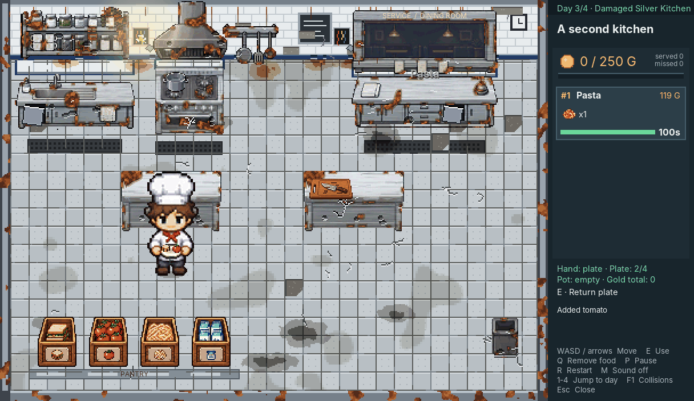

# Orders and kitchens: how it works

The orders/kitchens contribution started from **kitchen-demo-v0.8.1** and added two parts.
The current main branch also includes [shift deadlines and enemies](SHIFT_AND_ENEMIES.md).

- **Orders**: timed orders with gold, speed tips, a day target and days that
  get busier, an animated order panel, effects and sounds. This replaces the
  v0.8.1 order system.
- **Kitchens**: the four environment art sets (warm clean, warm overgrown,
  steel clean, steel damaged), room ambience and background music.

The menu, chef animations, carrying, chopping, cooking and shared pixel renderer
remain integrated. The v0.9.1 contribution had 230 checks; the current build
adds encounter and deadline coverage and updates movement tests for the faster chef.



---

## 1. Run it

```shell
python main.py                     # menu -> Play -> Day 1
python -m demos.orders_demo        # the order system on its own
python -m pytest tests -q          # every check
python -m tools.build_kitchens     # rebuild the four kitchen art sets
python -m tools.make_sounds        # rebuild the order sounds and music
```

On Windows use `.venv\Scripts\python.exe` in place of `python`.

**How to play one order**

1. A bell rings, a **"!"** flashes over the service hatch and a card slides
   into the sidebar. Its timer is already running.
2. Make the dish: pick up the plate, add food from the crates, chop a tomato
   at the board, or cook pasta in the pot.
3. Press **E** at the hatch before the timer runs out. Coins burst out and the
   gold floats up; the faster you were, the bigger the tip.
4. Reach the day's gold target, return the plate and press **Enter**.

---

## 2. What happens every frame

```text
INPUT              UPDATE (rules)                       DRAW (pictures)
key press   ->  1. move the chef                     reads snapshots only,
queued          2. cook and chop                     never changes the game
                3. order timers (expiry first!)
                4. handle queued E / Q presses
                5. order events -> panel, effects, sound
```

- **Rules and pictures are separate.** `restaurant/orders/system.py` does not
  import Arcade. `sidebar.py` and `effects.py` only draw.
- **Snapshots.** Systems exchange frozen records (`PlateSnapshot`,
  `OrderSnapshot`, ...) from `restaurant/shared/contracts.py`, so nobody can
  change another system's data by accident.
- **Timers before key presses.** An order that runs out this frame has
  already expired when the E press is handled, so it cannot be served late.

---

# Part A: Orders

## A1. The data: `restaurant/orders/models.py`

| Recipe | Needs | Base gold | Served |
| --- | --- | --- | --- |
| Sandwich | sandwich | 30 | by hand |
| Milk | milk | 30 | by hand |
| Lunch set | sandwich + milk | 50 | on the plate |
| Tomato sandwich | sandwich + tomato (raw or chopped) | 60 | on the plate |
| Pasta | cooked pasta | 90 | on the plate |

`DayRules` holds one day's tuning: gold target, order timer, arrival rate, at
most 3 orders on screen, the largest speed tip and which recipes may appear.

## A2. The rules: `restaurant/orders/system.py`

```text
arrives: live at once, timer starts        -> event "arrived"
   |-- try_serve(plate, food) in time      -> event "served", gold paid
   |   try_serve_held(food)
   '-- timer reaches zero first            -> event "expired", no gold
```

When the last order leaves the board, the next customer arrives within two
seconds, so there is always something to do but a moment to breathe.

Key details:

1. **Matching** compares counts, not order: `Counter(required) == Counter(plate)`.
   `recipe_item()` makes a chopped tomato count as "tomato". A `set` would
   lose duplicates and accept a wrong plate.
2. **One transaction.** `try_serve(plate, food)` checks the snapshot, then asks
   the food system to consume exactly that plate revision
   (`food.serve_plate(revision)`) and only then pays gold. A repeated key press
   finds a newer revision and fails. The chef keeps the empty plate.
3. **A failed serve changes nothing.** No counter, order or food changes.
4. **Gold rewards speed:** `gold = base + tip_max x (time left / patience)`.
5. **Day target:** reaching it raises a `day_complete` event and freezes the board.
6. **Events** (`OrderEvent`) are only for pictures and sound; the rules never
   depend on them.
7. **Big time steps** are split at every expiry and arrival, so one 300-second
   update gives the same result as 3000 small frames (tested).

## A3. The hatch: `GameView.use_service_hatch()`

E at the hatch:

1. carrying a plate with food -> try to serve it;
2. holding a sandwich or milk -> try to hand it over;
3. if it matched no order -> "sent back": buzz, shake, red flash, nothing lost;
4. empty hands -> a reminder to bring a plate, sandwich or milk.

## A4. The panel: `restaurant/orders/sidebar.py`

| Effect | How | Tutorial |
| --- | --- | --- |
| Cards slide in and close gaps | position eases towards its slot each update | Week 3 |
| Timer bar green, amber, red | colour by share of time left | - |
| Card blinks under 10 s | `int(time * 5) % 2 == 0` | Week 10 |
| A new card glows gold | soft radial texture with fading, pulsing alpha | Week 8 |
| Expired card turns grey | Pillow `ImageOps.grayscale` + `ImageEnhance.Brightness` -> `arcade.Texture` | Week 7 |
| Expired card shakes, then leaves | decaying `sin` offset | Week 10 |
| Gold counts up, coin pops | displayed value eases to the real one | Week 4 |

Shapes and icons go into the team's pixel canvas; every label goes through
`GameView.text()`, so type stays sharp.

## A5. World effects: `restaurant/orders/effects.py`

A small particle system with the same structure as the Week 9 smoke tutorial
(position, velocity, age, lifetime; update moves, draw fades, dead ones go):

| Trigger | Effect |
| --- | --- |
| Order arrives | sparkle, pulsing light and "!" over the hatch; recipe name floats up |
| Order served | spinning coins burst, bounce and fade; "+67 G" floats up |
| Wrong plate | camera shake (Week 10), red flash, "Wrong dish!" |
| Order expired | smaller shake and flash, "Order expired" |
| Day complete / ending | confetti over the kitchen |

## A6. Sound: `tools/make_sounds.py`, `restaurant/audio.py`

All order cues, ambience and both music loops are **synthesised by code**
(waveform x volume envelope; pitch slides for drips; noise for sparks). The
team owns them; there are no licences to worry about. `KitchenAudio` keeps the
food member's cues and bubble loop exactly as before and adds the new cues
plus one looping music track that stops on pause, mute and when hidden.

---

# Part B: Kitchens

## B1. Days: `restaurant/kitchen/days.py`

| Day | Kitchen (art folder) | Target | Order timer | New order every | Story |
| --- | --- | --- | --- | --- | --- |
| 1 | Overgrown (`warm_overgrown`) | 150 | 82 s | ~14 s | You take over an abandoned restaurant |
| 2 | Warm (`warm_clean`) | 220 | 68 s | ~11 s | The same kitchen, restored with your gold |
| 3 | Damaged Silver (`metal_damaged`) | 290 | 56 s | ~9 s | A second, run-down kitchen |
| 4 | Silver (`metal_clean`) | 360 | 45 s | ~7.5 s | The same kitchen, renovated |

Each day is busier: shorter timers, faster arrivals and a higher target (so
more orders to serve), never more than three orders on screen.
The overall shift budgets are 180, 165, 150 and 135 seconds. `GameView` checks
this deadline before processing E/Q; `OrderSystem` still owns individual orders.

Clean and damaged twins use the same furniture positions, footprints and
stations (the silver rooms swap the two islands, as in v0.8.1). Each day also
has a headline, story text, music and its effect points (puddles, broken panels).

## B2. The art pipeline: `tools/build_kitchens.py`, `tools/kitchen_fx.py`

```text
source picture --resize--> warm_clean
warm_clean ----------------> overgrow() ------> warm_overgrown
warm_clean --metalize()----> metal_clean
metal_clean ---------------> damage_metal() --> metal_damaged
```

**Why every file is on the art grid.** v0.8.1 draws the whole game on a
608 x 352 canvas, one art pixel per two world pixels, then enlarges it. So
every kitchen file is stored at exactly that grid size and drawn 1:1. Sprites
are processed at 4x that size, details are drawn in 4x4 blocks (one art
pixel each), and the result is reduced 4:1, so every crack and leaf lands on
exactly one game pixel instead of blurring.

**Why outlines never move.** Every variant starts from the same base and
keeps the base's alpha channel, so damage cannot change a footprint or hide a
station. A test checks this pixel for pixel.

| Technique | Used for | Tutorial |
| --- | --- | --- |
| HSV colour masks | find wood, teal paint and dark outline pixels | Week 11 |
| Luminance ramp recolour | wood -> steel while keeping the shading | Weeks 4, 7 |
| Value noise | organic patches for rot, rust, stains | Weeks 9, 11 |
| Min / Max filters | edge bands, seams, rust halos | Week 7 |
| Multiply / screen blends | stains and grime darken; brushed highlights lighten | Week 8 |
| Stepped thresholds | soft masks -> 2 or 3 flat tones (pixel-art look) | Week 11 |
| Procedural drawing | vines (random walk + leaves), cracks, moss, dents, drips, wires | Weeks 3, 4 |

**Metal:** wood and paint recoloured to steel, brushed grain, the dining room
through the hatch tinted blue. **Overgrown:** rot and worm holes, chipped
paint, damp streaks, mould, moss, vines; the room gets damp stains, moss in the
grout, cracked tiles with weeds, puddles, ivy and leaves. **Damaged steel:**
grime, rust on edges and seams with drips, dents, scratches, a door hanging
off its hinge, cracked oven glass; the room gets missing tiles, oil and rust
stains, missing wall tiles and broken panels with wires.

`room.png` repeats the geometry of `restaurant/kitchen/details.py` (tiles,
trim, rear upstands, mats, clock, chalkboard) so nothing moves compared with
v0.8.1. `details.py` stays: the menu uses it and the scene falls back to it if
an art folder is missing.

## B3. Atmosphere: `restaurant/kitchen/ambience.py`

| Kitchen | Ambience |
| --- | --- |
| Warm | dust motes in the light |
| Overgrown | drops fall into the painted puddles with ripples, a splash and a drip sound; fireflies |
| Silver | star glints on the steel |
| Damaged silver | broken panels spark with a flash and a zap; the lights flicker |

It runs on game time, so pause freezes it; nothing in it is solid.

---

## 3. Every special effect (for the report)

| # | Effect | Trigger | Kind |
| --- | --- | --- | --- |
| 1 | Hatch light, "!" bubble, sparkle, bell | order arrives | lighting, particles, audio |
| 2 | Card slides in and glows gold | order arrives | animation, lighting |
| 3 | Timer colour, blink, tick | under 10 s | visual, audio |
| 4 | Coins, floating gold, cash register | correct order | particles, audio |
| 5 | Gold counter count-up, coin pop | gold earned | animation |
| 6 | Shake, red flash, buzzer | wrong plate | camera, audio |
| 7 | Greyscale card, shake, sad tones | order expires | image processing, audio |
| 8 | Confetti, fanfare, results card | day target | particles, audio |
| 9 | Fade from black, story banner, transition sound | new day | transition |
| 10 | Drips, ripples, fireflies | overgrown kitchen | particles, audio |
| 11 | Sparks, flash, flickering light | damaged kitchen | particles, lighting, audio |
| 12 | Dust motes, steel glints | clean kitchens | particles |
| 13 | Background music per restaurant | day starts | audio |
| 14 | Steel, rust, rot and vine artwork | build tool | image processing |

The pot's rising bubbles, chopping animation and food sounds are v0.8.1 work.

---

## 4. Files changed outside orders and kitchens (for the pull request)

| File (owner) | Change | Why |
| --- | --- | --- |
| `restaurant/game_view.py` (Member 1) | service hatch, order events, effects, ambience, music, day banner, results card, fade, keys 1-4, camera shake, moving labels | connect the new systems; food and chopping code unchanged |
| `restaurant/kitchen/days.py` (Member 1) | days carry art folder, story, music, order rules, effect points; story order | the environment art and difficulty per day |
| `restaurant/kitchen/scene.py` (Member 1) | loads each day's art set and `room.png`, falls back to the originals | four real kitchens |
| `restaurant/audio.py` (Member 2) | adds order cues, ambience and music; existing cues and bubble loop unchanged | one sound bank |
| `restaurant/shared/contracts.py` (all) | `OrderSnapshot.patience_seconds/reward`, `OrderStats.target`, `ServeResult.gold`, new `OrderEvent`; all defaulted | old callers keep working |
| `restaurant/demo_check.py` (Member 1) | checks live orders instead of opening service; checks all four kitchens | new order flow |
| tests (team) | order expectations in `test_campaign`, `test_cooking_orders`, `test_chopping_system`, `test_kitchen`, `test_pixel_art` updated | new rules; food checks unchanged |

Nothing was deleted. The food sounds in `assets/audio/` are untouched;
`accept.wav` and `serve.wav` are no longer used by the game but kept.

## 5. Decisions the team should confirm

1. **Who owns orders.** `TEAM_PLAN.md` gave orders to Member 2; this replaces
   that system. Agree on it before merging.
2. **Day order** follows the story (overgrown first). To restore v0.8.1's order,
   reorder the `DAYS` tuple; nothing else depends on it.
3. **Gold values and targets** live in `models.py` and `days.py`; easy to tune.

## 6. Not done / limitations

- Tested on Linux with software rendering, not on Windows; the Windows EXE
  was not rebuilt. Run the game, the tests and the self-test on Windows.
- Sounds were checked by measurement (valid files, levels, seamless loops),
  not by ear. Volumes are in `restaurant/audio.py`.
- No walking customers (order cards only), one chef design.
