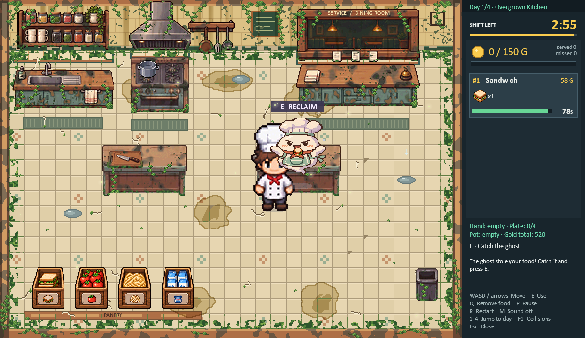
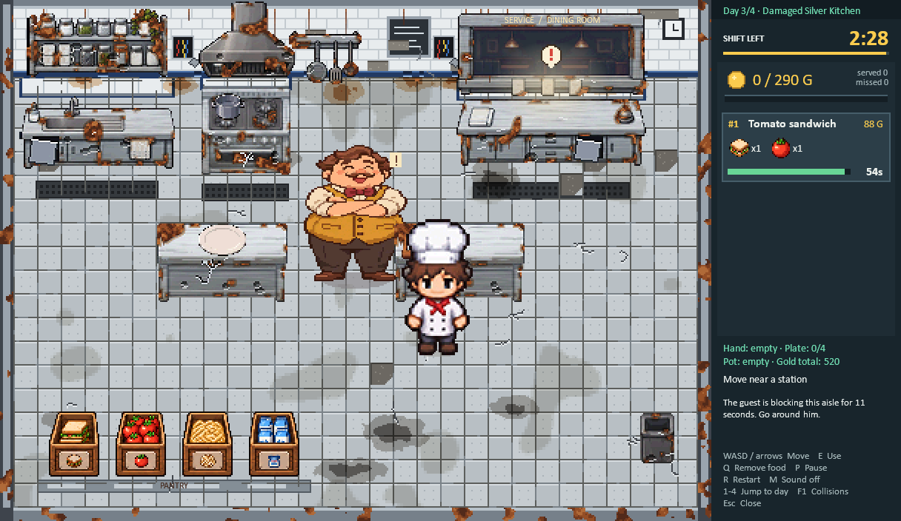
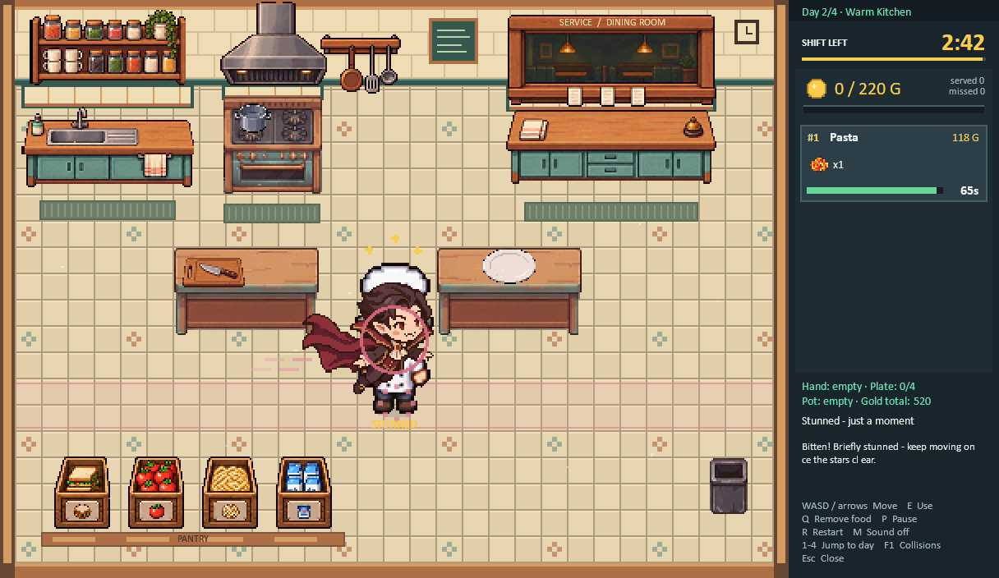
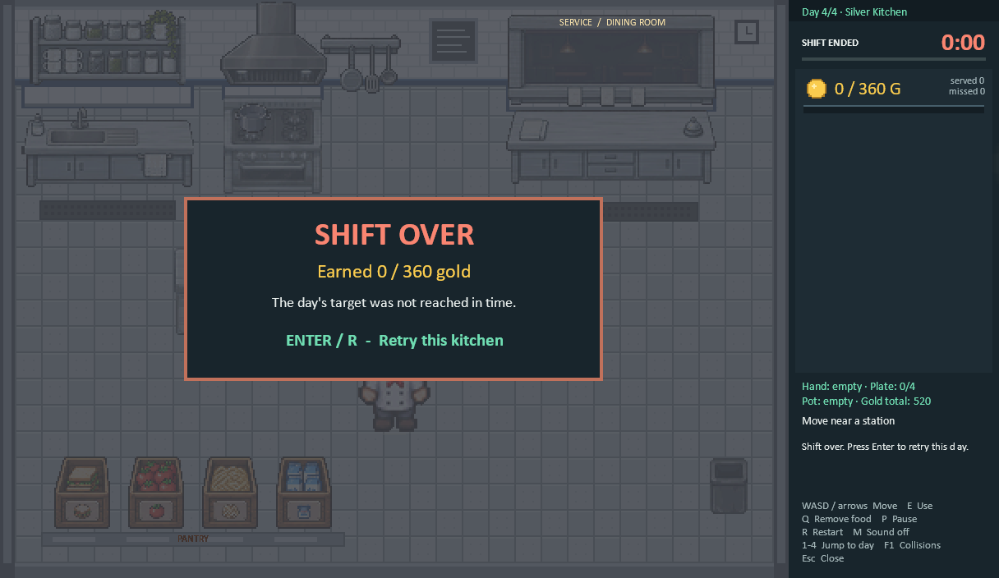

# Shifts and kitchen encounters

This update builds on the team's v0.9.1 live orders and four kitchens. It is
integrated into `main`; the other members' branches are not changed.



## Play rules

The shift clock fits in the existing sidebar header above the gold meter and
order cards. It turns coral with 30 seconds left and ticks during the final
15 seconds. Reach the target before zero. At zero, gameplay stops and a
failure panel offers Enter/R to retry the same day. Failed-attempt gold is
removed from the campaign total; earlier successful days keep their gold.
Once the target is reached, the clock and encounters stop, allowing the plate
to be returned without a deadline. Pausing freezes every gameplay timer.

| Day | Gold target | Shift | Each order | Blocking guests | Vampire |
| --- | ---: | ---: | ---: | --- | --- |
| 1 — Overgrown | 150 | 3:00 | 82 s | None | None |
| 2 — Warm | 220 | 2:45 | 68 s | None | First warning at 33 s |
| 3 — Damaged silver | 290 | 2:30 | 56 s | At most one | First warning at 30 s |
| 4 — Silver | 360 | 2:15 | 45 s | At most two | First warning at 27 s |

The chef moves at **230 pixels/second**, 15% faster than the previous 200.
Individual order patience is about 10% shorter. Arrival intervals, prices,
tips, recipes, station locations and carrying/chopping frames are retained.

## Ghost: protect the plate

Every second expired order can summon one ghost, with a two-second warning.
Only one ghost can exist at once. It floats to the plate table and takes the
food only if the plate is docked and has food on it at that moment. It never
takes the plate, food in the chef's hand, or food on a carried plate.

After a short pause it flees to the nearest side at 125 pixels/second, slower
than the chef. Within 76 foot-position pixels, press E to recover all its food
onto the plate and banish it. E can also banish an approaching ghost. The same
press does not also interact with a station. Food recovery is all-or-nothing:
if the plate is full or contains incompatible pasta, the ghost keeps its
payload and the message asks you to make room. Escaping offscreen loses that
food. There is a 15-second cooldown after escape.

## Guest: take another aisle

After two expired orders on day 3 or 4, a stocky guest may stop in an aisle.
Day 4 allows a second appearance after four misses and an 18-second gap after
the first guest leaves. A gold floor marker warns for two seconds. The guest
then blocks a **72 × 32** foot area for 11 seconds, with a small arrival dust
burst and an impatience mark. His portrait is larger than his foot collider.

Placement is conservative: avoid stations, furniture and the chef; inflate
obstacles by the chef's foot dimensions; flood-fill the free floor; verify a
route from the chef to every interaction point. Check again when the warning
ends. If the chef steps into the warning marker, cancel that appearance and
try later. An unavailable safe position postpones the encounter, rather than
creating a trap. Standing directly below him can naturally hide his body
behind the chef, because both participate in the scene's depth ordering.

## Vampire: step out of the lane

From day 2, a vampire marks the nearer of two open horizontal aisles. Its
two-second warning includes arrows and a sound. It then sweeps straight across,
alternating sides, at 345/360/375 pixels per second for days 2/3/4. After it
exits, the next warning is 39/34/29 seconds later. Move out of the red band.

Contact causes one **0.8-second stun per sweep**, a ring flash, flying pixels,
orbiting stars and a bite cue. Movement, station actions and chopping progress
pause during stun; cooking, orders and the shift continue. Held movement keys
resume once the stun ends. Releasing a key while stunned still releases it.
No food, gold or health is taken. Movement is swept in short time steps so a
slow frame cannot let the vampire pass through a stationary chef undetected.





## Files and integration

| File | Responsibility |
| --- | --- |
| `restaurant/kitchen/days.py` | Per-day shift duration, order patience, target and menus |
| `restaurant/shared/settings.py` | Chef movement speed |
| `restaurant/hazards/system.py` | Pure encounter states, triggers, timing, food ownership and event messages |
| `restaurant/hazards/navigation.py` | Safe blocker candidates and station-route verification |
| `restaurant/hazards/renderer.py` | Static portraits, warning markers, float motion, trails, dust, stars and bite flash |
| `restaurant/game_view.py` | Countdown, failure/retry, E priority, stun, dynamic collision and sound integration |
| `restaurant/ingredients/system.py` | Atomic theft/recovery methods; no enemy drawing or movement |
| `assets/enemies/` | Three transparent PNG source portraits, one per enemy |
| `tools/make_encounter_sounds.py` | Rebuild the nine original synthesized WAV cues |
| `tests/test_encounters.py`, `tests/test_shift_game.py` | Rules and actual Arcade input/collision/render checks |

`Encounters.update(dt, inventory, player_feet)` advances the encounters;
`missed_order()` receives an actual expiration event. `reclaim(inventory,
player_feet)` returns an action result, or None if no ghost is close enough.
`blocker_rectangle` returns the active solid rectangle or None; GameView adds
and removes exactly that collision sprite. `drain_events()` returns messages
and sound names. `clear()` removes every threat on success, failure or reset.

Ingredient hooks are `steal_docked_food()` and `restore_stolen_food(items)`.
Both update the plate revision so existing order-service checks cannot consume
a stale plate. The ghost owns the returned tuple until successful recovery or
escape. Never copy that tuple back twice or modify private inventory fields.

Coordinates for encounters are **feet**, matching `player.ground_position`.
Existing station targets are sprite centres, so their Y coordinate is converted
by subtracting 32. Kitchen props and the solid guest share depth sorting. Ghosts
and the vampire are supernatural floating sprites and may pass over furniture.
All artwork uses the same two-world-pixel framebuffer as the kitchen and chef,
with nearest sampling; UI labels remain at screen resolution.

The three PNG portraits were generated with OpenAI ImageGen for this update,
then kept unchanged as source assets. Transparent padding is measured at load
time using the same alpha threshold as the renderer. There are no additional
enemy sprite frames; bobbing, travel and effects are drawn by Arcade. See
`assets/enemies/README.md` for the asset prompts and provenance.

## Run and verify

```powershell
python main.py
python -m pytest -q
python main.py --self-test artifacts/check
python -m tools.make_encounter_sounds
python -m PyInstaller --noconfirm PlayerDemo.spec
```

The executable self-test includes actual order-expiry ghost triggering, theft,
E recovery, a solid guest and verified station routes, vampire warning/bite/stun,
pause, deadline failure and retry. It saves gameplay screenshots alongside its
JSON report. The portable ZIP includes these assets and sounds and can run the
same `--self-test` without an installed Python environment.

For development, number keys 1–4 still jump to a fresh day and F1 shows colliders.
These are demo shortcuts, not a progression lock. Balance values are exposed
above for further playtesting; passing automated checks does not measure every
player's skill or guarantee a particular difficulty rating.
