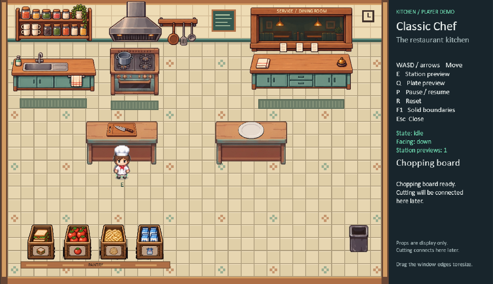

# Restaurant kitchen layout

The room is **960 x 704 world pixels**, about 14% less area than v0.3.0. A
256-pixel sidebar sits outside it. The chef remains 56 x 92, so the smaller room
feels more proportionate without shrinking the character or its animations.

The layout follows a simple route: pantry crates, chopping island, stove,
plate island, then the **service hatch into the dining room**. The plate island
has only an empty plate. The pot sits on the front-left burner. A sink, draining
area, shelves, extractor, utensils and tickets give the kitchen a purpose.
The service hatch is a visible pass for food; the chef cannot walk through it.

These are display props. E previews stations; food collection, chopping,
cooking and order completion still belong to the other systems. No hold-item
animations are included.

## Collisions and drawing order

The chef has a stable **32 x 20 foot hitbox**, centered 32 pixels below the
sprite center. The hat and shoulders do not act like invisible walls.
`PlayerController.position` is still the sprite center, so existing hooks are
compatible. `ground_position` returns the foot center for depth and shadows.
See [Arcade's hitbox API](https://api.arcade.academy/en/3.3.3/api_docs/api/hitbox.html).

`KitchenProp.rectangle` describes the visible image. `footprint` is a local
`(offset_x, offset_y, width, height)` rectangle measured around its floor base.
`collision_rectangle` converts it to world coordinates. All floor-standing
furniture has a footprint entirely inside its image, with no added padding.
Raised worktops can overlap the chef's body visually; feet cannot enter bases.

`KitchenScene.draw_order()` sorts furniture and the chef from back to front
using ground positions. Decorations stay attached to their supporting table.
This lets the chef disappear naturally behind counters and appear in front
when approaching their near edge. F1 shows the actual foot/base rectangles.
The large F1 circles are interaction ranges, not collision boundaries.

## Editing the map

Edit `restaurant/kitchen/layout.py` for furniture, footprint and target positions.
Walls close all four sides, including the service hatch. Flat mats and wall
shelves are decoration, not floor obstacles. Every new floor-standing object
must have a footprint. Keep supported objects inside their parent furniture.

`restaurant/kitchen/scene.py` draws the scene. `details.py` draws crisp tiled
flooring and architectural trim with batched Arcade shapes. Prepared art lives
in `assets/kitchen/`; the Windows build includes the entire folder.

Targets use the chef's sprite-center coordinates. `choose_target` uses a radius
of 64 world pixels. Only the nearby marker appears normally; F1 reveals all
markers/ranges. Run the tests after moving furniture: exact target routes and
all accessible obstacle sides are checked with the actual foot dimensions.

## Integration hooks

- `InteractionTarget("chopping_board", "chop", 300, 302)` previews future cutting.
- `InteractionTarget("plate", "plate", 620, 302)` handles the E/Q plate intents.
- `InteractionTarget("serve", "serve", 744, 472)` is now at the service hatch.

These stable IDs reach `GameView.handle_interaction(action, target)`. Connect
future system methods there. Keep food state out of `PlayerController`.
No cutting timer, inventory or order logic is created by this demo.

Box IDs/IngredientId contracts stay unchanged. The supplied crates depict
sandwich, tomato, noodles and milk; agreed game IDs remain lettuce, tomato,
bread and cheese. Agree final recipes/art with the group before implementing
collection; these pictures do not supply working ingredients today.

## Window, checks and packaging

Startup prefers a 1040-pixel logical width and fits the height to the room's
aspect ratio. It measures Windows display scaling and the monitor work area
before showing the window, leaving margins for the frame/taskbar. Resizing
keeps the whole scene visible without stretching. Text uses the displayed size.

Run `python -m pytest tests -q` on a desktop with graphics support.
`python main.py --self-test artifacts/kitchen-check` captures the scene and F1
overlay and writes `self-test.json`. The same argument works on PlayerDemo.exe.
Rebuild with `python -m PyInstaller --noconfirm PlayerDemo.spec`; distribute the
whole PlayerDemo folder with its `_internal` folder, not the EXE alone.
