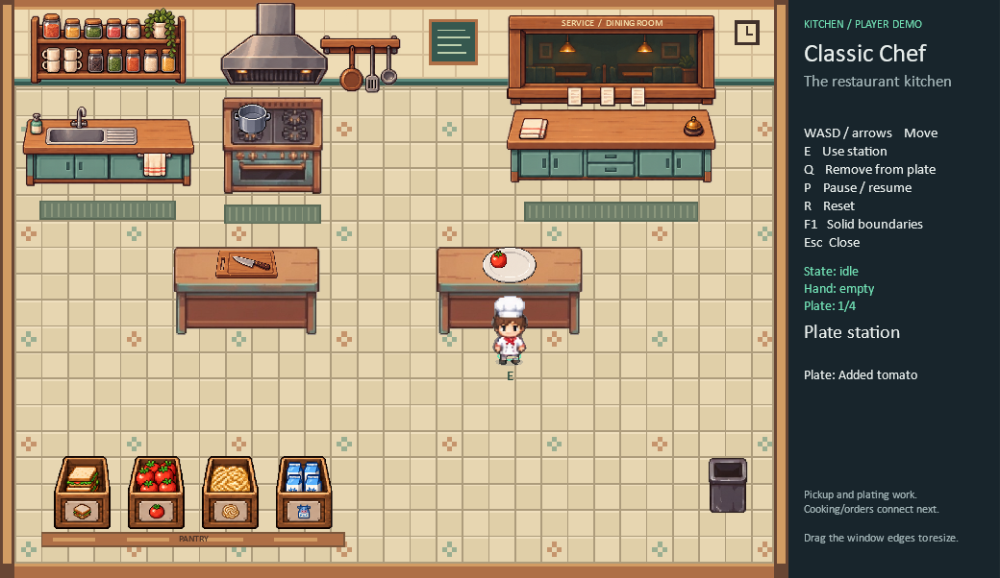
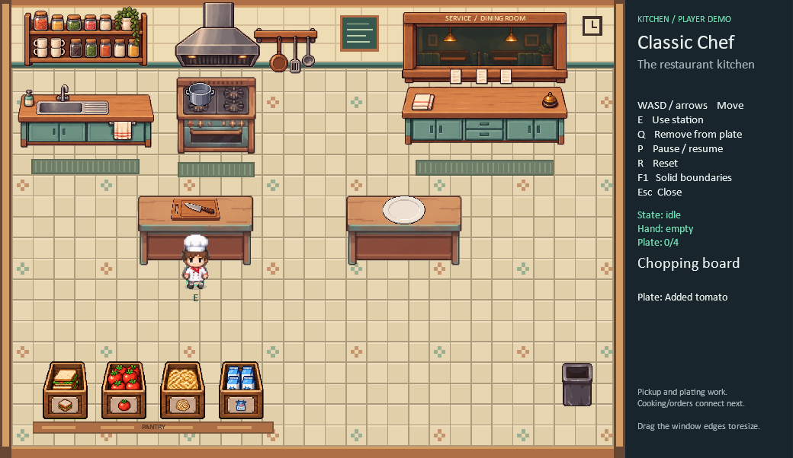

# Combined team baseline — v0.5.0, 3 November 2026

111 source tests passed on Windows with Arcade 3.3.3. Task2 history and code are
merged with the kitchen branch. Matching task2 crates, food, plate and empty pot
are loaded directly into the main scene, and public IngredientSystem methods
handle pickup, add/remove, discard and reset. Current IDs match the artwork.

The extracted Windows ZIP passed 38 application checks, including collecting a
tomato and displaying it on the real kitchen plate. Python/source paths were
removed from its environment. Independent ingredient-demo tests also pass.

Default window: 1040 x 602 logical/physical pixels at 100% scaling on a 2560 x
1440 work area. The complete native window fits; resize rendering and collision
outlines were inspected. This is local Windows verification.

Read TEAM_PLAN.md for the current three member assignments. Kitchen variants,
physical plate transport, cooking, orders and sound are assigned future work.
The shared baseline is distributed to main, task2 and feature/kitchen-background
using normal fast-forward updates after preserving both histories in a merge.

---

# Delivery verification

## Restaurant design and closer collisions — v0.4.0, 21 October 2026

Windows 11, Python 3.12.14, Arcade 3.3.3. **69 source tests** and **36 packaged
application checks** passed. The standalone ZIP was extracted into a new folder
with spaces, then run with Python/source paths removed from its environment.
The normal scene, resized scene and collision overlay were visually inspected.

- Kitchen area reduced about 14%, to 960 x 704; chef retains its native size.
- Plate island contains only the plate; pot sits over one stove burner.
- Matching sink, shelves, extractor, board and restaurant service hatch; the
  hatch visibly opens onto a dining room and retains the existing serve ID.
- All furniture bases checked from every accessible side. Exact station
  reachability includes the fixed 32 x 20 foot hitbox, offset 32 pixels down.
- Close approach verified: the feet stop within 2 pixels of a table base.
  Front/behind drawing order tested, including actual rendering behind a table.
- Input, animation, idle/facing, wall sliding, thin obstacles, pause/reset/focus,
  one E action per key press and feedback-only cutting/serving remain covered.
- Display-scale checks retain 100%, 125%, 150% and 200% cases. The actual default
  client was 1040 x 601 logical units / 1300 x 752 physical pixels at 125%.
  Its complete native outer frame remained inside the desktop work area.
- Runtime uses Arcade and Python's standard library. Artwork is bundled.
  Ingredient, cutting and order behavior remain future integration work.

Earlier v0.1, v0.2 and v0.3 releases remain available for history. This verification
covers the local Windows machine, not other teammates' computers.
